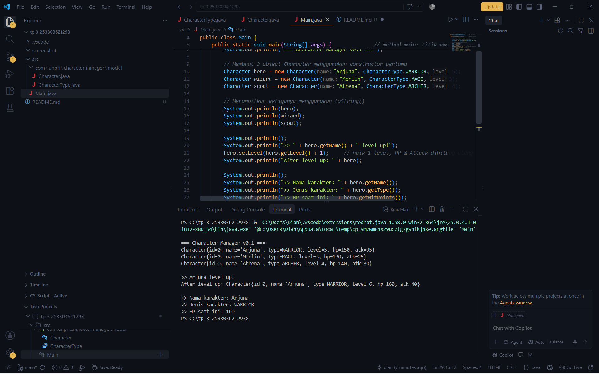

# Character Manager - TP3 (Java Visual SIH-6406)

Deskripsi
Character Manager merupakan program sederhana berbasis Java untuk mengelola karakter game. Program ini menggunakan konsep OOP seperti class, constructor, enum, encapsulation, getter, dan setter. Fitur tambahannya adalah atribut mana dengan validasi nilai negatif serta method `isAlive()` untuk memeriksa apakah karakter masih hidup.

## Output Program

## struktur folder project

tp 3 253303621293/
├── .vscode/
│   └── settings.json
├── screenshot/
│   └── output-tp3.png
├── src/
│   ├── com/
│   │   └── unpri/
│   │       └── charactermanager/
│   │           └── model/
│   │               ├── Character.java
│   │               └── CharacterType.java
│   └── Main.java
└── README.md

Identitas Mahasiswa

Nama Lengkap:Dian Enda Hapsari
NIM:253302621293
Google Docs Bagian D: [Klik di sini](https://docs.google.com/document/d/1EnGNuJ_O0jHTm5pgvTzrEUnLDiQgN19IORD_BQLvz6A/edit?tab=t.0)