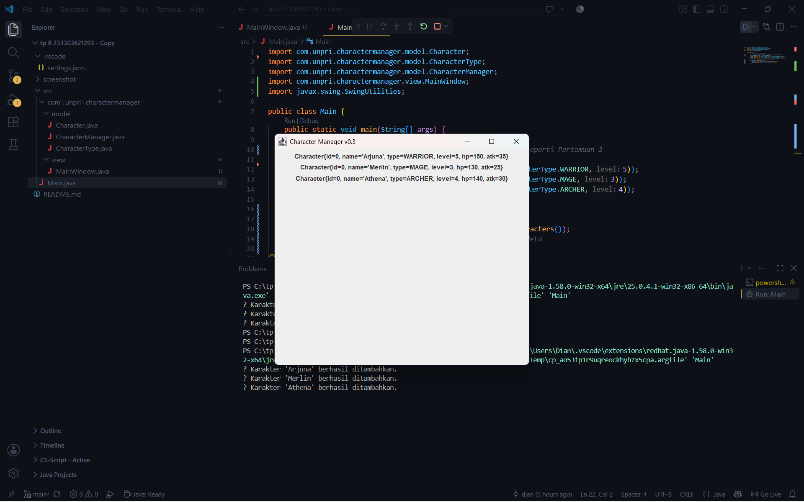
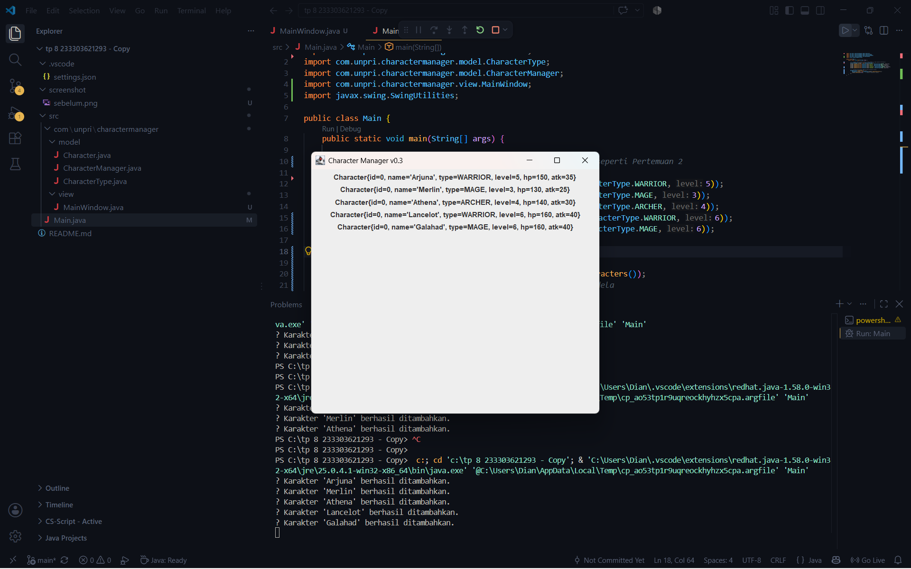

### 1. screenshot output

- Screenshot MainWindow sebelum perubahan data:

- Screenshot setelah data diubah:

### 2. Aliran Data dan Konsep MVC

Pada aplikasi Character Manager, `Main.java` berfungsi sebagai titik awal program untuk membuat data karakter dan memasukkannya ke dalam `CharacterManager` menggunakan method `addCharacter()`. Selanjutnya, data diambil melalui method `getAllCharacters()` dan dikirimkan ke `MainWindow` untuk ditampilkan pada antarmuka pengguna. Dalam konsep MVC (Model-View-Controller), class `Character` dan `CharacterManager` berperan sebagai Model yang mengelola data, sedangkan `MainWindow` berperan sebagai View yang menampilkan data karakter. Pemisahan ini membuat pengelolaan data dan tampilan antarmuka lebih terstruktur serta mudah dikembangkan.

### 3. Daftar Karakter dan Alasan Pemilihan Tipe/Level

| Nama     | Tipe    | Level | Alasan Pemilihan                                                    |
| Arjuna   | WARRIOR | 5     | Dipilih sebagai karakter petarung dengan level menengah.            |
| Merlin   | MAGE    | 3     | Dipilih sebagai karakter penyihir dengan level awal.                |
| Athena   | ARCHER  | 4     | Dipilih sebagai karakter pemanah dengan level menengah.             |
| Lancelot | WARRIOR | 6     | Dipilih sebagai petarung dengan level lebih tinggi daripada Arjuna. |
| Galahad  | MAGE    | 6     | Dipilih sebagai penyihir dengan level lebih tinggi daripada Merlin. |

Setiap karakter memiliki tipe dan level yang berbeda untuk menunjukkan bahwa aplikasi dapat menyimpan serta menampilkan data karakter secara dinamis. Nilai HP dan attack power dihitung berdasarkan level menggunakan method `calculateBaseHP()` dan `calculateBaseAttack()` pada class `Character`.
Aliran Data: Main, CharacterManager, MainWindow dikaitkan dengan MVC Main membuat objek CharacterManager lalu mengisinya dengan karakter lewat method addCharacter(). Setelah data siap, Main membuat MainWindow di dalam SwingUtilities.invokeLater() dan mengirim objek CharacterManager ke konstruktornya. MainWindow kemudian mengambil daftar karakter lewat getAllCharacters() dan rata-rata level lewat getAverageLevel(), lalu menampilkannya ke JLabel menggunakan perulangan. Dalam konsep MVC, CharacterManager dan Character adalah Model yang menyimpan data, MainWindow adalah View yang menampilkan data, sedangkan Controller belum ada karena belum ada input dari pengguna yang perlu diproses.

### 4. Link Google Docs untuk Bagian D

Dokumen pengerjaan Bagian D dapat diakses melalui tautan berikut:

[Tugas Bagian D — Google Docs](https://docs.google.com/document/d/10FKY3LqzMJsd6WPgZMXqHFIh4QsDaMAtAMfWeSDFqm4/edit?usp=sharing)